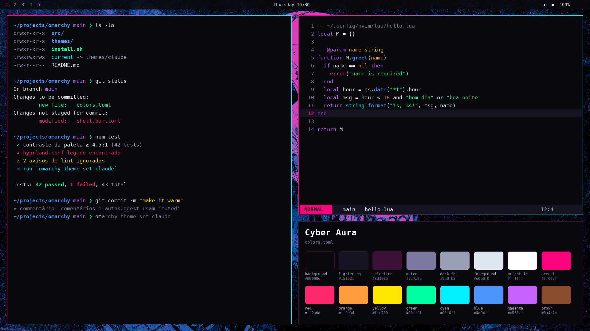
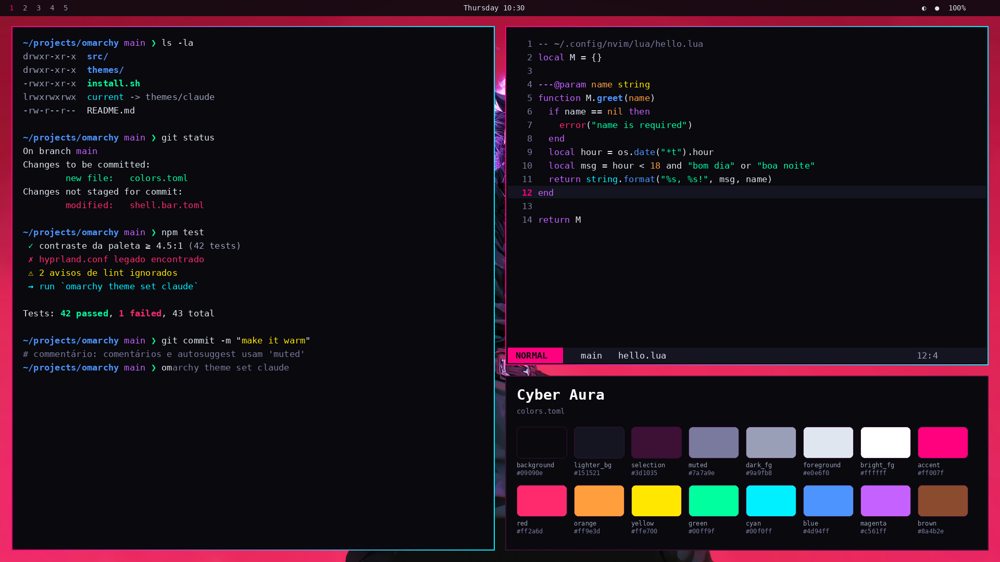
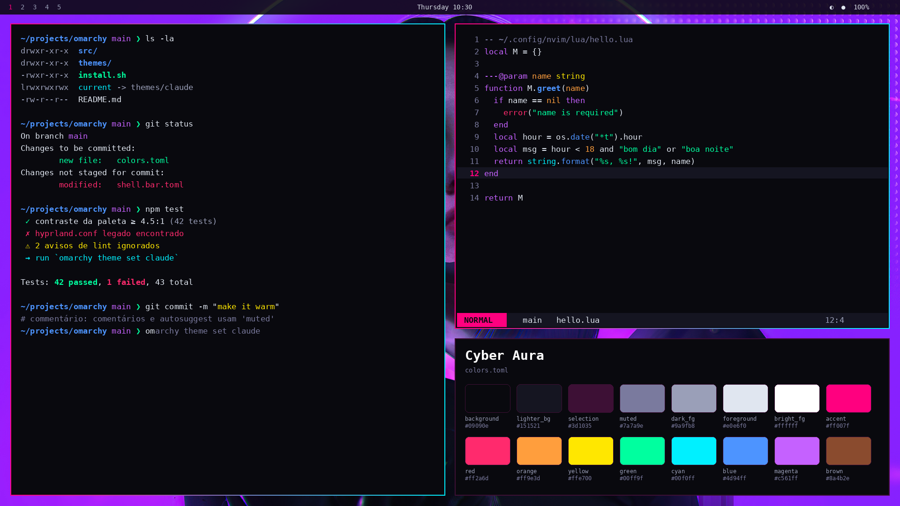
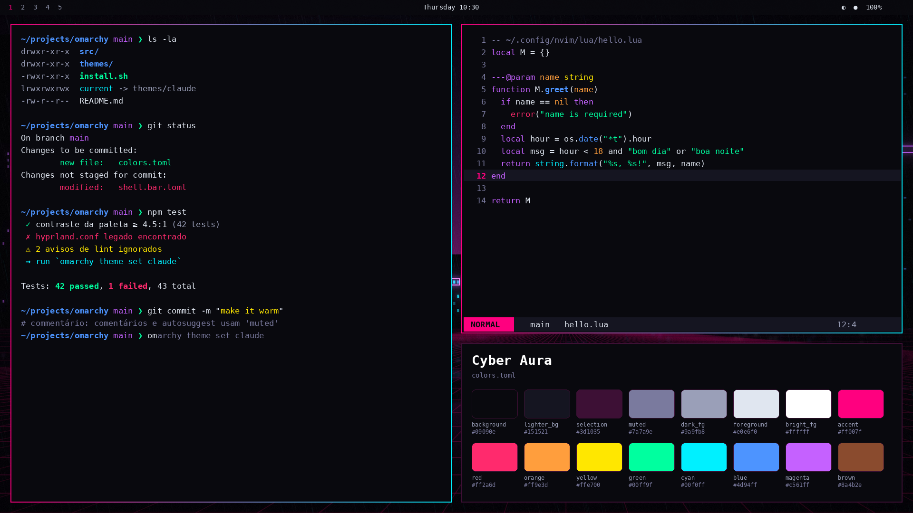

# Cyber Aura

A neon cyberpunk theme for [Omarchy](https://omarchy.org), tuned for reading text in the terminal.

> Requires **Omarchy 4** or newer.

## Quick Install

```bash
omarchy theme install https://github.com/joaovic-tech/omarchy-cyber-aura-theme
```

Or use *Install › Style › Theme* in the Omarchy menu and paste the URL.

## Previews






## Colors

Every ANSI color has its own hue and reaches at least 4.5:1 contrast against the background.

| Role | Color | Hex |
|------|-------|-----|
| Background |  | `#09090e` |
| Surface |  | `#151521` |
| Selection |  | `#3d1035` |
| Muted (comments) |  | `#7a7a9e` |
| Foreground |  | `#e0e6f0` |
| Accent |  | `#ff007f` |
| Red |  | `#ff2a6d` |
| Orange |  | `#ff9e3d` |
| Yellow |  | `#ffe700` |
| Green |  | `#00ff9f` |
| Cyan |  | `#00f0ff` |
| Blue |  | `#4d94ff` |
| Purple |  | `#c561ff` |

The active window border is a pink → cyan gradient.

## Transparent terminal with blur

Omarchy ignores terminal configs shipped by themes installed from git, so transparency lives in your own config. Blur is off by default in Omarchy 4.

`~/.config/hypr/looknfeel.lua`:

```lua
hl.config({
  decoration = {
    blur = { enabled = true, size = 8, passes = 3, new_optimizations = true, xray = false, vibrancy = 0.2 },
  },
})
```

`~/.config/foot/foot.ini` (only the background becomes transparent, text stays fully opaque):

```ini
[colors-dark]
alpha=0.85
```

## Notes

- When installed from git, Omarchy drops `neovim.lua` and generates the Neovim colors from `colors.toml` instead. To use the hand-tuned Neovim highlights, clone the repo somewhere else and symlink it into `~/.config/omarchy/themes/cyber-aura`.

---

This theme is under the **MIT** license. If you like it, please leave a ⭐ on the repository!
